# 🛒 Data Digger
### Enterprise-Grade E-Commerce Relational Database Architecture & Query Simulation | MySQL & phpMyAdmin

<p align="center">
  
  
  
  
  
</p>

<p align="center">
  <b>A comprehensive, production-modeled relational database architecture demonstrating Data Definition Language (DDL), Data Manipulation Language (DML), Aggregate Functions, Date Arithmetic, and Relational JOIN Operations.</b>
</p>

---

## 📌 Executive Summary & Project Overview

**Data Digger** ek real-world e-commerce relational database architecture simulation hai. Is project ka primary objective ek complete scalable store model design karna hai jisme:
1. **Customer Records** aur unke delivery profiles maintain hote hain.
2. **Order Header Ledger** ke through billing aur order placement history record hoti hai.
3. **Inventory & Product Catalog** ke stock levels aur item price bands organize hote hain.
4. **Order Line-Items (`OrderDetails`)** ke through many-to-many relationship normalize karke gross revenue calculate hota hai.

Ye project academic rigor ke sath **Referential Integrity Constraints (Primary & Foreign Keys)**, **Relational Algebra (Multi-Table JOINs)**, aur **Business Analytics (Aggregations & Date Filters)** demonstrate karta hai.

---

## 📄 Project Documentation & Academic Deliverables

Complete lab assessment ke liye niche diye gaye core files repository me include ki gayi hain:

| Document / Asset | Description | Format |
|---|---|---|
| **`data-digger.docx`** | **Comprehensive Academic Word Report** formatted in a strict **1 Query + 1 phpMyAdmin Execution Screenshot per Page** layout. | MS Word (`.docx`) |
| **`PR-1.sql`** | Complete raw SQL production script with schema definitions, sample seed datasets, and analytical queries. | SQL Source (`.sql`) |
| **`Data-Digger-Demo.mp4`** | Detailed technical video walkthrough presenting live query execution in phpMyAdmin console. | Video (`.mp4`) |
| **Execution Proofs (`.png`)** | 20+ High-definition screenshot proofs validating exact SQL output tables and execution timestamps. | PNG Images |

---

## 🎥 Project Video Walkthrough

Live phpMyAdmin execution demo dekhne ke liye repository folder me **`Data-Digger-Demo.mp4`** check karein:

[▶ Watch the Data Digger Project Video Walkthrough](Data-Digger-Demo.mp4)

---

## 🗄️ Relational Database Architecture & ER Diagram

Database architecture 4 core entities me strictly normalized hai:

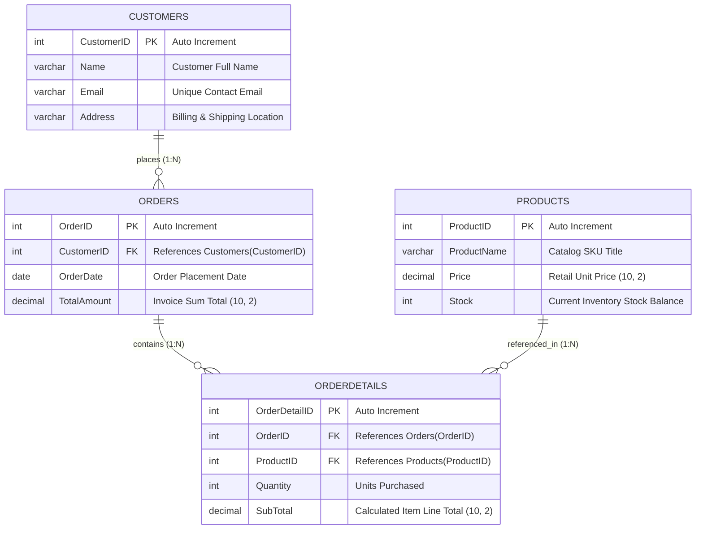

### Architectural Entity Specifications

| Table | Business Purpose | Primary Key | Foreign Key Relationship | Cascade / Action Rules |
|---|---|---|---|---|
| **`Customers`** | Client master database storing profile and geographical billing addresses | `CustomerID` | None | Parent entity |
| **`Orders`** | Transaction header ledger tracking order timestamps and grand invoice balances | `OrderID` | `CustomerID` ➔ `Customers(CustomerID)` | Restrict / Enforce referential parent record |
| **`Products`** | Inventory catalog storing SKU descriptions, unit retail prices, and stock volume | `ProductID` | None | Parent entity for item sales |
| **`OrderDetails`** | Normalized junction table mapping order headers to catalog items with calculated line sub-totals | `OrderDetailID` | `OrderID` ➔ `Orders(OrderID)`<br>`ProductID` ➔ `Products(ProductID)` | Multi-parent referential integrity |

---

## ✨ Key Technical Competencies & Concepts Demonstrated

* **Data Definition Language (DDL):** `CREATE TABLE`, `AUTO_INCREMENT`, `PRIMARY KEY`, and `FOREIGN KEY` constraints.
* **Data Manipulation Language (DML):** CRUD lifecycle (`INSERT`, `SELECT`, `UPDATE`, `DELETE`) with strict filtering logic.
* **Aggregate Functions & Business Intelligence:** `SUM()`, `AVG()`, `COUNT()`, `MAX()`, and `MIN()` metrics.
* **Relational Joins & Grouping:** Multi-table `INNER JOIN` operations combined with `GROUP BY` and `ORDER BY ... DESC LIMIT`.
* **Temporal Filtering:** Dynamic date calculations using `CURDATE()` and `DATE_SUB(..., INTERVAL 30 DAY)`.

---

## 🧪 Comprehensive SQL Queries & Execution Evidence

Niche har ek table ki production queries aur unke corresponding visual proofs ka detailed breakdown hai:

### 1. Database Schema & Table Creation (DDL)

```sql
-- 1. Customers Table Schema
CREATE TABLE Customers (
    CustomerID INT AUTO_INCREMENT PRIMARY KEY,
    Name VARCHAR(100),
    Email VARCHAR(100),
    Address VARCHAR(255)
);

-- 2. Orders Table Schema
CREATE TABLE Orders (
    OrderID INT AUTO_INCREMENT PRIMARY KEY,
    CustomerID INT,
    OrderDate DATE,
    TotalAmount DECIMAL(10, 2),
    FOREIGN KEY (CustomerID) REFERENCES Customers(CustomerID) 
);

-- 3. Products Table Schema
CREATE TABLE Products (
    ProductID INT AUTO_INCREMENT PRIMARY KEY,
    ProductName VARCHAR(100),
    Price DECIMAL(10, 2),
    Stock INT
);

-- 4. OrderDetails Table Schema
CREATE TABLE OrderDetails (
    OrderDetailID INT AUTO_INCREMENT PRIMARY KEY,
    OrderID INT,
    ProductID INT,
    Quantity INT,
    SubTotal DECIMAL(10, 2),
    FOREIGN KEY (OrderID) REFERENCES Orders(OrderID),
    FOREIGN KEY (ProductID) REFERENCES Products(ProductID)
);
```

---

### 2. Customers Table: Master Data Management

<div align="center">
  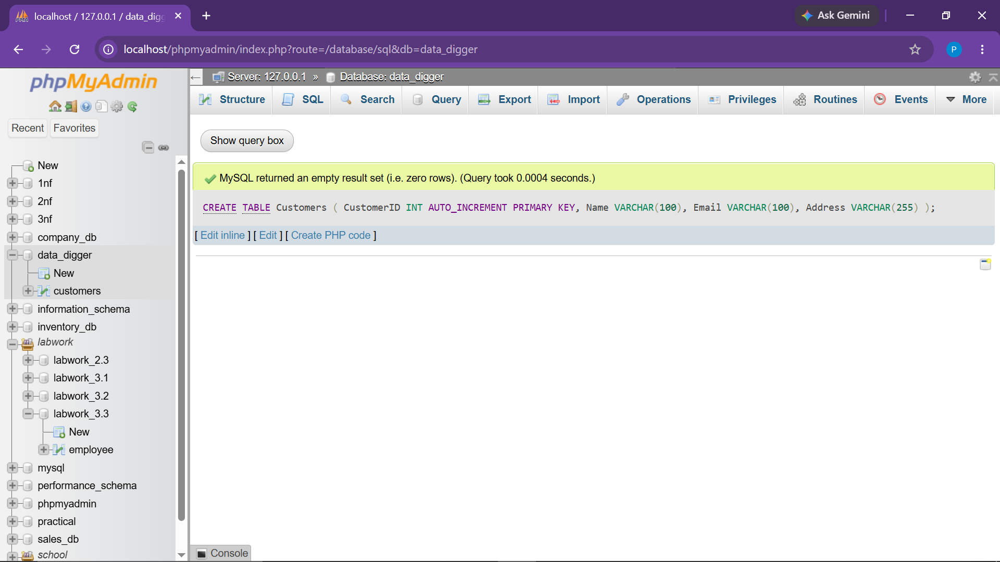
</div>

#### Queries Implemented:
* **2.1 Seed Sample Customers:**
  ```sql
  INSERT INTO Customers (Name, Email, Address) VALUES
  ('Alice', 'alice@example.com', '123 MG Road, Mumbai'),
  ('Bob Smith', 'bob@example.com', '456 Park Avenue, Delhi'),
  ('Charlie Brown', 'charlie@example.com', '789 Ring Road, Bangalore'),
  ('Alice', 'alice.wonder@example.com', '12 Lake View, Pune'),
  ('David Warner', 'david@example.com', '34 Civil Lines, Jaipur');
  ```
* **2.2 Retrieve All Customers:**
  ```sql
  SELECT * FROM Customers;
  ```
* **2.3 Update Customer Address:**
  ```sql
  UPDATE Customers SET Address = '999 New Residency, Mumbai' WHERE CustomerID = 1;
  ```
* **2.4 Delete Customer by Primary Key:**
  ```sql
  DELETE FROM Customers WHERE CustomerID = 5;
  ```
* **2.5 Filter Customers by Name Criterion:**
  ```sql
  SELECT * FROM Customers WHERE Name = 'Alice';
  ```

<p align="center">
  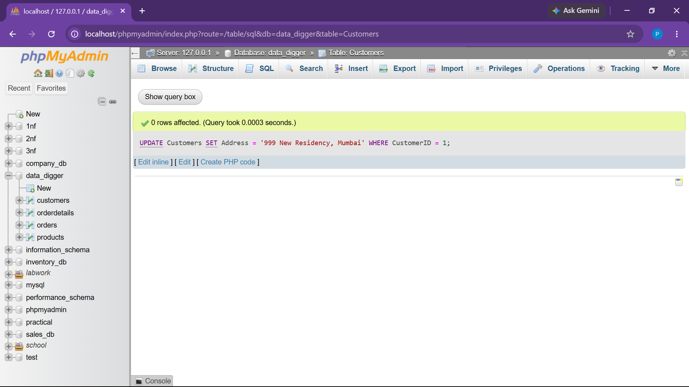
  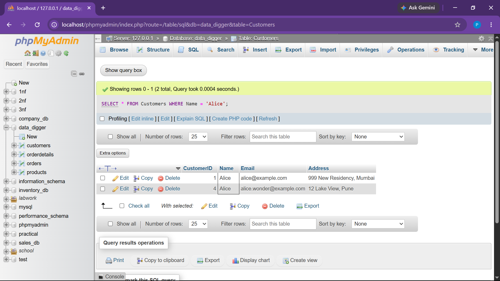
</p>

---

### 3. Orders Table: Sales Ledger & Date Arithmetic

<div align="center">
  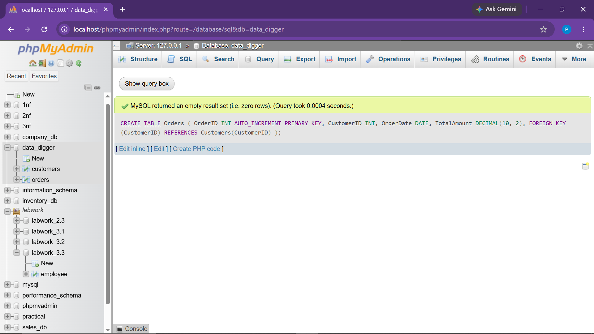
</div>

#### Queries Implemented:
* **3.1 Insert Sample Orders:**
  ```sql
  INSERT INTO Orders (CustomerID, OrderDate, TotalAmount) VALUES
  (1, CURDATE(), 2500.00),
  (2, DATE_SUB(CURDATE(), INTERVAL 10 DAY), 1200.00),
  (3, DATE_SUB(CURDATE(), INTERVAL 25 DAY), 4500.00),
  (1, DATE_SUB(CURDATE(), INTERVAL 45 DAY), 800.00),
  (4, CURDATE(), 1500.00);
  ```
* **3.2 Query Orders for a Specific Customer:**
  ```sql
  SELECT * FROM Orders WHERE CustomerID = 1;
  ```
* **3.3 Update Order Total Balance:**
  ```sql
  UPDATE Orders SET TotalAmount = 2800.00 WHERE OrderID = 1;
  ```
* **3.4 Delete Order Entry:**
  ```sql
  DELETE FROM Orders WHERE OrderID = 5;
  ```
* **3.5 Temporal 30-Day Window Filter:**
  ```sql
  SELECT * FROM Orders WHERE OrderDate >= DATE_SUB(CURDATE(), INTERVAL 30 DAY);
  ```
* **3.6 Aggregate Statistical Metric Extraction (MAX, MIN, AVG):**
  ```sql
  SELECT 
      MAX(TotalAmount) AS HighestOrderAmount,
      MIN(TotalAmount) AS LowestOrderAmount,
      AVG(TotalAmount) AS AverageOrderAmount
  FROM Orders;
  ```

<p align="center">
  
  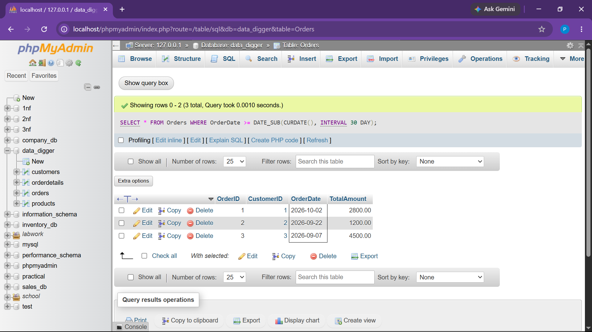
</p>

<div align="center">
  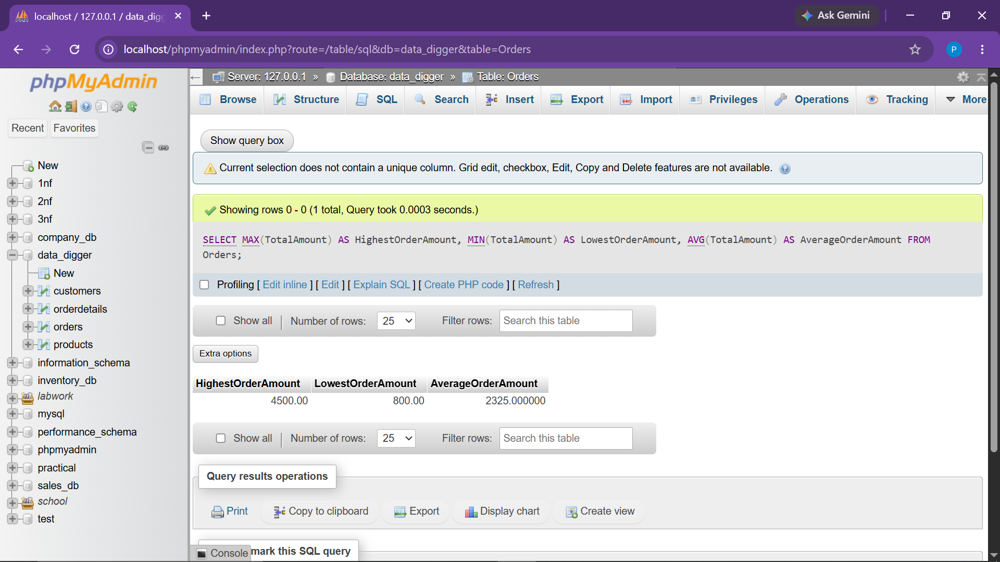
</div>

---

### 4. Products Table: Inventory & Price Analysis

<div align="center">
  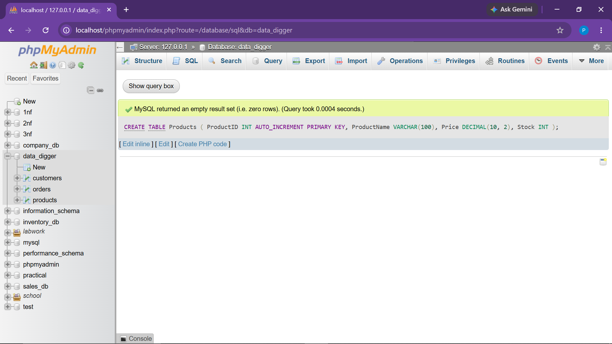
</div>

#### Queries Implemented:
* **4.1 Insert at Least 5 Catalog SKU Products:**
  ```sql
  INSERT INTO Products (ProductName, Price, Stock) VALUES
  ('Wireless Mouse', 650.00, 50),
  ('Mechanical Keyboard', 1800.00, 20),
  ('USB-C Hub', 450.00, 0), -- Out of stock item
  ('Gaming Headset', 2200.00, 15),
  ('Bluetooth Speaker', 1200.00, 30);
  ```
* **4.2 Retrieve Catalog Sorted by Price (Descending):**
  ```sql
  SELECT * FROM Products ORDER BY Price DESC;
  ```
* **4.3 Update Retail Price of a Specific Product:**
  ```sql
  UPDATE Products SET Price = 1950.00 WHERE ProductID = 2;
  ```
* **4.4 Delete Out-of-Stock Products (Stock = 0):**
  ```sql
  DELETE FROM Products WHERE Stock = 0;
  ```
* **4.5 Price Band Filtering Range (₹500 to ₹2,000):**
  ```sql
  SELECT * FROM Products WHERE Price BETWEEN 500 AND 2000;
  ```
* **4.6 Identify Boundary Pricing with MAX() and MIN():**
  ```sql
  SELECT 
      MAX(Price) AS MostExpensivePrice,
      MIN(Price) AS CheapestPrice
  FROM Products;
  ```

<p align="center">
  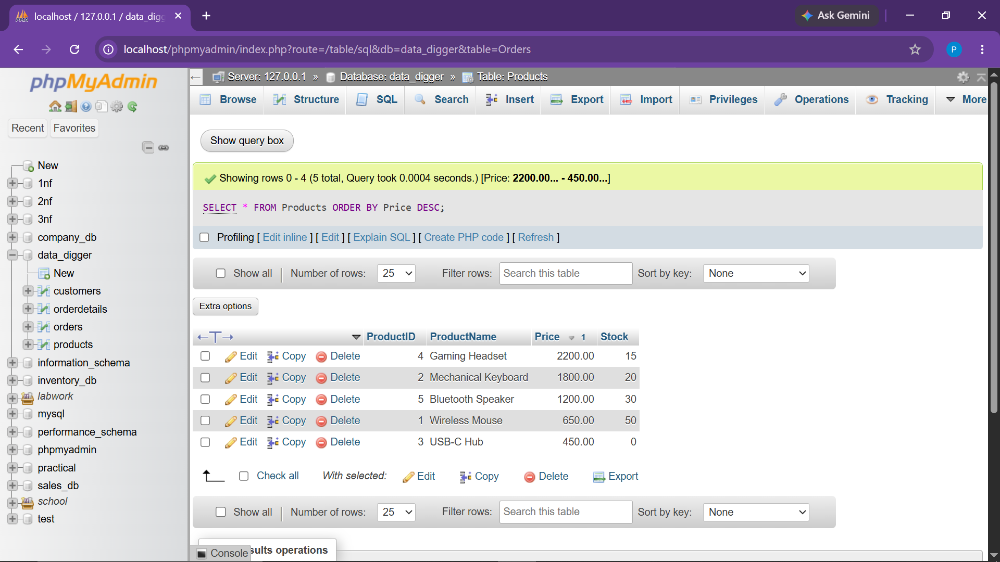
  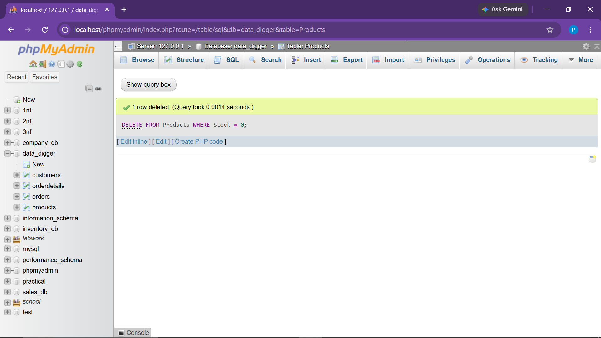
</p>
<p align="center">
  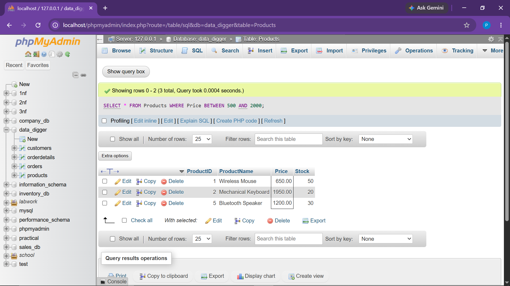
  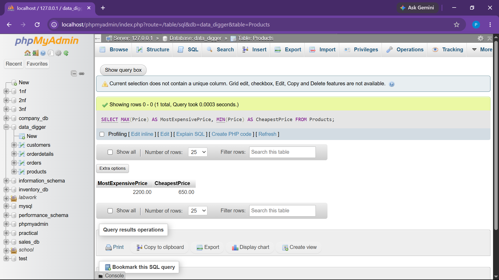
</p>

---

### 5. OrderDetails Table: Multi-Table Relational JOINs & Gross Store Revenue

<div align="center">
  
</div>

#### Queries Implemented:
* **5.1 Insert Relational Line Items:**
  ```sql
  INSERT INTO OrderDetails (OrderID, ProductID, Quantity, SubTotal) VALUES
  (1, 1, 2, 1300.00),
  (1, 2, 1, 1950.00),
  (2, 5, 1, 1200.00),
  (3, 4, 2, 4400.00),
  (4, 1, 1, 650.00);
  ```
* **5.2 Extract Line Items for a Specific Order (OrderID = 1):**
  ```sql
  SELECT * FROM OrderDetails WHERE OrderID = 1;
  ```
* **5.3 Aggregate Total Gross Store Revenue:**
  ```sql
  SELECT SUM(SubTotal) AS TotalRevenue FROM OrderDetails;
  ```
* **5.4 Multi-Table INNER JOIN + GROUP BY Analytics (Top 3 Best Selling Products):**
  ```sql
  SELECT 
      p.ProductID,
      p.ProductName,
      SUM(od.Quantity) AS TotalQuantityOrdered
  FROM OrderDetails od
  JOIN Products p ON od.ProductID = p.ProductID
  GROUP BY p.ProductID, p.ProductName
  ORDER BY TotalQuantityOrdered DESC
  LIMIT 3;
  ```
* **5.5 Count Sales Occurrence Frequency for SKU (ProductID = 1):**
  ```sql
  SELECT COUNT(*) AS TimesSold FROM OrderDetails WHERE ProductID = 1;
  ```

<p align="center">
  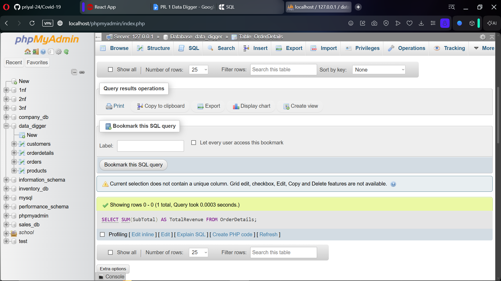
  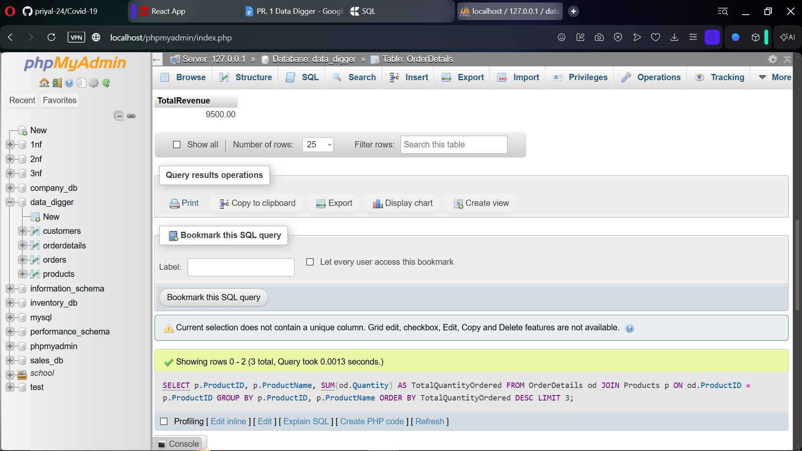
</p>
<p align="center">
  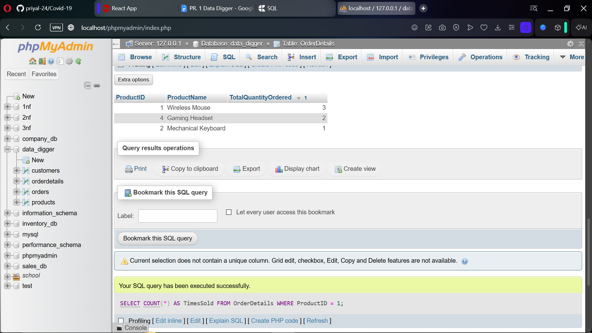
  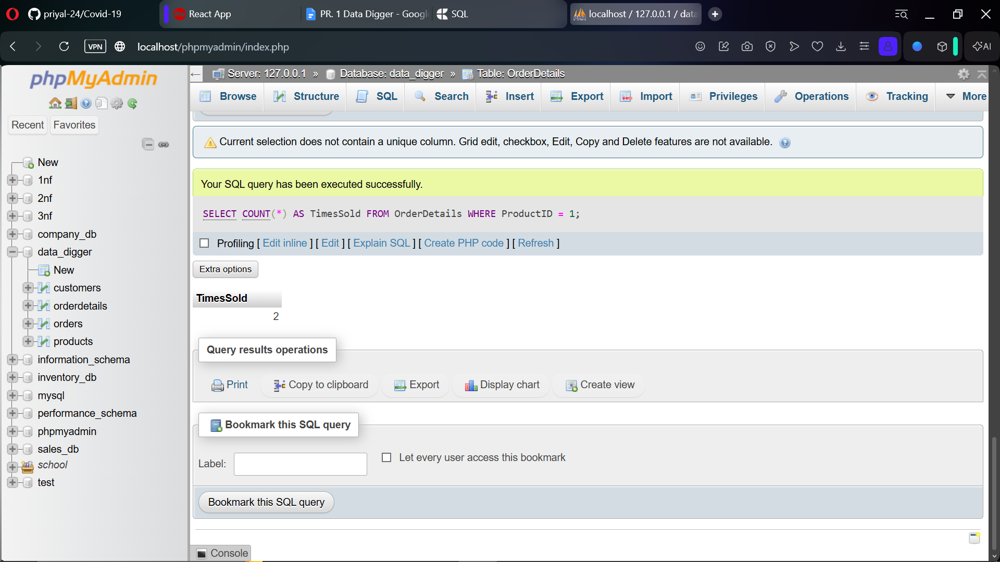
</p>

---

## 🧰 Technology Stack & Environment

* **Relational Database Engine:** MySQL Server 8.0+
* **Database Administration Client:** phpMyAdmin 5.2 & MySQL Workbench
* **Web Server Stack:** Apache HTTP Server (XAMPP Environment)
* **Query Language:** Standard ANSI SQL (Structured Query Language)
* **Documentation & Formatting:** Microsoft Word 2021 (`data-digger.docx`)

---

## 🚀 Installation & Execution Guide

### Local Database Setup

1. **Clone the Repository:**
   ```bash
   git clone https://github.com/priyal-24/Data-Digger.git
   cd Data-Digger
   ```

2. **Start MySQL Server:**
   XAMPP / WampServer control panel open karke **Apache** aur **MySQL** services start karein.

3. **Import via phpMyAdmin:**
   - Browser me `http://localhost/phpmyadmin/` open karein.
   - `data_digger` naam ka ek naya database create karein.
   - **Import** tab par click karein aur repository folder se **`PR-1.sql`** select karke execute karein.

4. **Run via MySQL Command Line Client:**
   ```bash
   mysql -u root -p data_digger < PR-1.sql
   ```

---

## 📁 Complete Repository File Tree

```text
Data-Digger/
├── README.md                               # Complete Enterprise Project Documentation
├── data-digger.docx                        # Complete Production SQL Source Code
├── Data-Digger-Demo.mp4                    # Technical Demonstration Video Walkthrough
├── CustomerTable.png                       
├── CustomerQuery1.png                      
├── CustomerQuery2.png
├── CustomerQuery3.png  
├── CustomerQuery4.png  
├── CustomerQuery5.png                      
├── OrderTable.png                          
├── OrderQuery1.png                         
├── OrderQuery2.png
├── OrderQuery3.png
├── OrderQuery4.png
├── OrderQuery5.png
├── OrderQuery6.png                                                      
├── ProductTable.png                        
├── ProductQuery1.png                      
├── ProductQuery2.png                       
├── ProductQuery3.png                       
├── ProductQuery4.png
├── ProductQuery5.png 
├── ProductQuery6.png                        
├── OrderdetailTable.png                   
├── OrderdetailQuery1.png                  
├── OrderdetailQuery2.png                  
├── OrderdetailQuery3.png                  
├── OrderdetailQuery4.png                  
└── OrderdetailQuery5.png                 
```

---

## 👩‍💻 Student & Author Details

* **Author:** Priyal Patel
* **GitHub Profile:** [@priyal-24](https://github.com/priyal-24)
* **Academic Course:** Relational Database Management Systems (RDBMS & SQL)
* **Project Name:** Data Digger – E-Commerce Database Architecture

---

<p align="center">
  <i>Developed with academic diligence, rigorous SQL normalization, and structured database engineering.</i>
</p>
